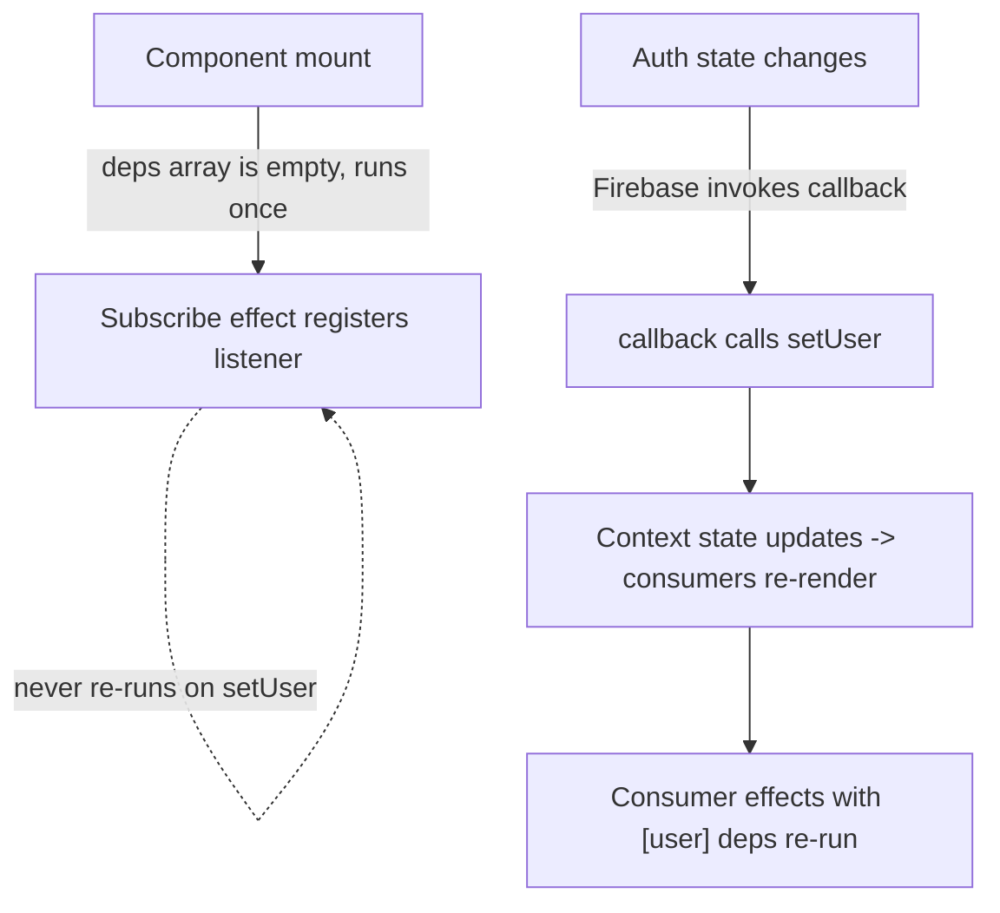

# Firebase Auth State, Context & `useEffect`

> [!abstract] The question
> When `onAuthStateChanged` calls `setUser`, does it "trigger the `useEffect` hook again"?
> Yes — **but only a *consumer* effect that depends on `[user]`**, not the effect that registered
> the listener. Those are two different effects, and conflating them causes subtle bugs.

Related: [[DocuLyze — Architecture]]

---

## The three roles, kept separate

### 1. The effect that *subscribes* — runs once
The `useEffect` that calls `onAuthStateChanged`, with `[]` deps, runs a **single time on mount**.
Its only job is to hand Firebase a callback and return the unsubscribe function for cleanup.
Calling `setUser` does **not** re-run this effect — and you don't want it to (re-running would
unsubscribe and re-subscribe needlessly).

> [!note] This is why the listener keeps firing "from inside a useEffect"
> The subscription lives independently of React's render cycle. The effect executes once; the
> *callback it registered* is what Firebase invokes many times.

### 2. The callback Firebase invokes — fires repeatedly
On every auth change (sign-in, sign-out, token refresh) Firebase calls the callback →
it calls `setUser(...)` → context state updates → every component reading `user` re-renders.

### 3. *Consumer* effects with `[user]` deps — re-run
A **different** effect — e.g. `useEffect(..., [user])` in `Header` — runs again because its
dependency (`user`) changed. **This** is the effect that "triggers again."

---

## The causal chain

```
mount
  └─ subscribe effect (deps []) runs ONCE → registers onAuthStateChanged listener
auth changes (login / logout / token refresh)
  └─ Firebase calls the callback → setUser(...)
       └─ context re-renders all consumers of `user`
            └─ consumer effects with [user] re-run    ← "the useEffect that runs again"
       (the subscribe effect does NOT re-run)
```



---

## So, is the original sentence right?

> "`onAuthStateChanged` enables its parameter function to execute and call `setUser`, which then
> triggers the `useEffect` hook again."

Correct **if** "the `useEffect` hook" means a *consumer* effect depending on `[user]` (like the one
in `Header`). It is **not** the same effect that registered the listener — that one fires its
callback many times but only ever executes itself once.

> [!warning] The trap
> If you put `onAuthStateChanged` in an effect whose deps include `user`/`setUser` and that array
> isn't stable, the subscribe effect re-runs on every auth change → unsubscribe/re-subscribe loop.
> Keep the subscribing effect on `[]`.

---

## The pattern this points to

> [!tip] Single source of truth
> - Put `onAuthStateChanged` **once** in `AuthProvider` with `[]` deps (subscribe on mount).
> - Let the **callback own `setUser`**.
> - Every component just **reads** `user` / `loading` from context.
>
> Re-renders and `[user]` effects then propagate everywhere automatically. No component needs its
> own listener, and nothing depends on a form remembering to call `setUser` before a redirect
> (which is what broke login → Header updates earlier).

See [[DocuLyze — Architecture#Client-side auth state]] for the consolidation this replaces.

---

## Does `setUser` need to be in the dependency array?

> [!question] `useEffect(() => { onAuthStateChanged(...) }, [setUser])` — is `[setUser]` necessary?
> **No.** Here `[setUser]` and `[]` behave identically, because the setter is referentially stable.

`setUser` comes from `useAuth()`, which returns the **raw `useState` setter** created in
`AuthProvider`. React guarantees that setter is **stable** — the same function object on every
render, for the component's whole lifetime. So a dependency array containing only `setUser` never
changes → the subscribe effect runs **once on mount** either way.

The only reason to list it is the **`react-hooks/exhaustive-deps` lint rule**: `setUser` is
referenced inside the effect, so the linter wants it declared. Including it satisfies the rule and
is harmless — but it's safe *only because* the setter is stable.

> [!warning] When it stops being safe
> The stability is a property of how `AuthProvider` exposes `setUser`. If you ever change the
> provider to pass an **inline / recreated** function (e.g. `setUser={(u) => normalize(u)}` without
> `useCallback`), then `setUser` becomes a new reference every render:
> - with `[setUser]` → the effect unsubscribes/re-subscribes **on every render** (subscribe loop);
> - with `[]` → the effect subscribes once but closes over a **stale** `setUser`.
>
> So the dependency choice and the provider's implementation are coupled. Keep the raw setter
> stable (don't wrap it, or wrap it in `useCallback`).

**Bottom line:** for a subscription that should live for the component's lifetime, the intent is
"run once" → `[]` expresses that directly. `[setUser]` is equally correct *today* and keeps the
linter quiet, as long as `setUser` stays the stable `useState` setter. See [[#The trap]] — the
danger is a dep that *isn't* stable, not the presence of `setUser` itself.
