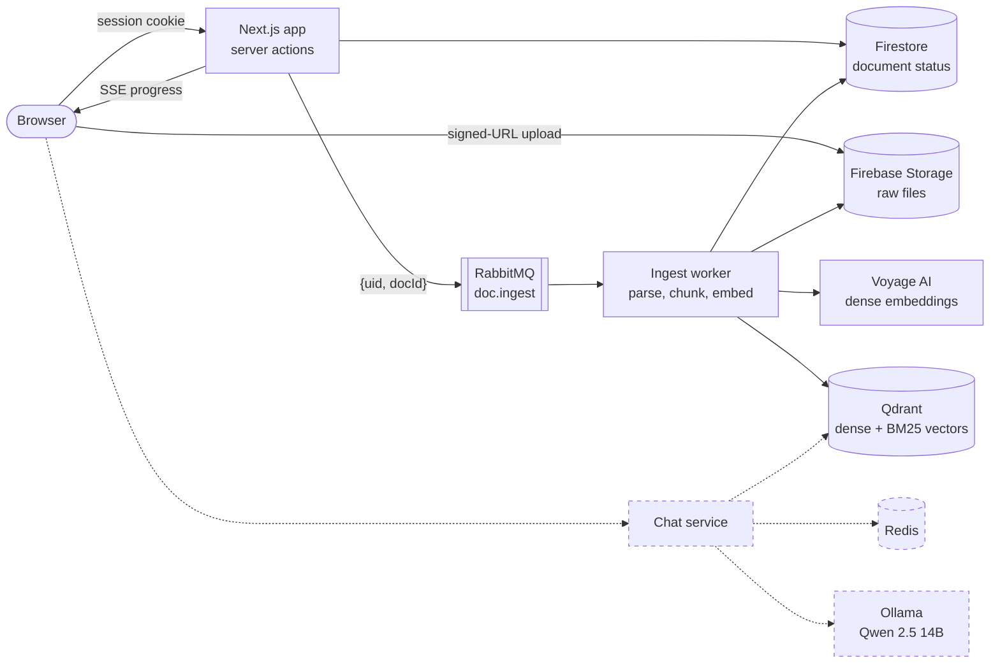
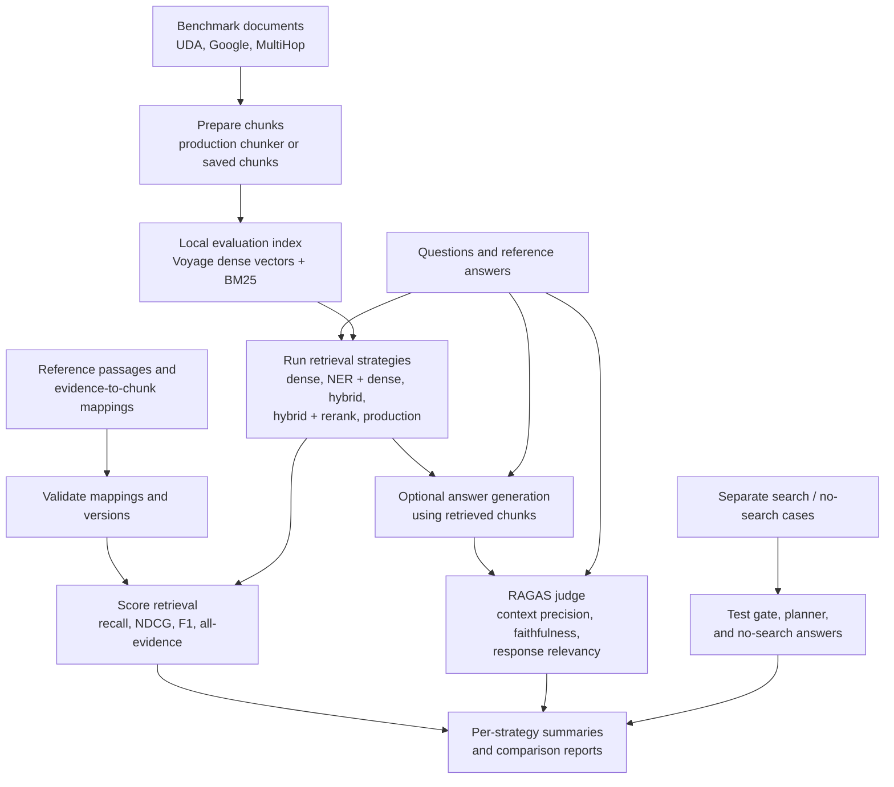

# DocuLyze

DocuLyze is a study tool my friends and I use to get through course material faster. You upload lecture notes, papers, slides, or code, and DocuLyze turns them into a searchable knowledge base you can ask questions against, with answers grounded in your own documents (retrieval-augmented generation).

It is built as separate services: a Next.js web app, a Python ingest pipeline behind a RabbitMQ queue, and (in progress) a chat service that generates answers locally with Qwen 2.5 through Ollama.

## Status

| Area | Status |
|---|---|
| Accounts, sign-in, and sessions | Built |
| Document upload and archive | Built |
| Ingest pipeline (parse, chunk, embed, index) | Built |
| Live pipeline progress (SSE) | Built |
| Hybrid retrieval (dense + BM25 with RRF) | Built |
| Retrieval evaluation harness | Built |
| Chat service (Redis cache, SSE token streaming, Qwen 2.5 14B via Ollama) | Built |
| CI/CD with GitHub Actions | Built |
| Kubernetes deployment with autoscaling | Built |

## Architecture



Dashed boxes and arrows are in progress.

### Web app (`doculyze/`)

Next.js 16 (App Router), React 19, TypeScript, and Tailwind CSS v4. Server actions act as the backend, so there is no separate API server.

- **Auth.** Firebase email/password sign-in. The ID token is exchanged for an httpOnly session cookie, and every data read and write is authorized from that cookie on the server, never from client state.
- **Upload.** Files go straight from the browser to Firebase Storage through a short-lived signed URL (up to 5 MB). The server picks the storage path and content type, then verifies the object landed before writing the Firestore record. PDF, Word (.docx), Markdown, plain text, HTML, and common source-code files are accepted.
- **Hand-off to ingest.** After an upload is confirmed, the app publishes a small `{uid, docId}` message to RabbitMQ. The file bytes never go through the queue. A broker outage never fails an upload: the document waits at `uploaded` and can be picked up later.
- **Live progress.** A per-document Server-Sent Events stream shows each upload moving through Uploading, Queued, Parsing, and Ready (or Failed).
- **Archive.** The dashboard lists your documents and their processing status.
- **Logging.** Structured operational logs through Winston with daily file rotation.

### Ingest worker (`ingest-worker/`)

A Python 3.12 service that consumes the `doc.ingest` queue one message at a time with manual acknowledgement.

1. **Claim.** A Firestore transaction moves the document from `uploaded` to `processing`, with a lease that expires so a crashed worker's job can be safely re-run.
2. **Check.** A magic-number precheck rejects files whose bytes don't match their claimed type.
3. **Parse to Markdown** in a sandboxed subprocess with a per-parser timeout:
   - PDFs: PyMuPDF (`pymupdf4llm`), the fast path for PDFs that have a text layer
   - Scanned PDFs with no text layer: a second pass with Docling and RapidOCR
   - Word, HTML, and XML: Docling, which keeps headings and tables
   - Text and code: read as UTF-8, with code wrapped in fenced blocks
4. **Chunk.** Header-aware and table-aware splitting with LangChain's `MarkdownHeaderTextSplitter` and `RecursiveCharacterTextSplitter`, sized with `tiktoken`.
5. **Embed and index.** Each chunk gets a dense Voyage `voyage-3.5-lite` vector and a sparse BM25 vector (fastembed). Both are written to Qdrant through a tenant gateway that applies the user filter itself, so no caller can read or write across users.
6. **Finish.** The worker reads the chunks back to confirm the write, then marks the document `ready`. Bad files end at `failed`.

A document that is temporarily busy goes to a retry queue and comes back after five minutes. Unexpected errors go to a dead-letter queue (`doc.ingest.dead`) instead of retrying forever, so a non-empty dead queue always means something is wrong with the system, not with a user's file.

### Chat service 

The chat service runs as its own backend:

- Retrieve with Qdrant hybrid search (dense + BM25, fused with RRF), optionally reranked with Voyage `rerank-3-lite`.
- Generate answers locally with **Qwen 2.5 14B served by Ollama**, so study material never leaves our machines for generation.
- Conversations are saved into Firestore for persistence.
- Stream answers token by token to the browser over **SSE**.

Qwen 2.5 has already been prototyped through Ollama for extracting named entities from documents.

## Retrieval and answer evaluation

The evaluation compares five retrieval strategies: dense Voyage embeddings; named-entity-first dense retrieval (`ner_dense`); dense + BM25 hybrid search; hybrid search with reranking; and the production pipeline with its needs-search gate, query planner, hybrid search, reranking and merged results. The November 8 runs cover three benchmarks and two UDA scopes. Results are means over scored cases, not claims of general production accuracy.

**Interpretation:** the evidence mappings are provisional and have not been human reviewed. UDA has 17 questions across 17 filings and papers, with 15 scored for retrieval; two questions are answer-only and eight draft placeholders are excluded. Its `document` scope searches only the source document, while `corpus` searches all 17 documents; the latter includes questions whose wording may be ambiguous across documents. Google uses 36 questions across three documents; MultiHop uses 10 questions across 109 articles, of which eight are scored for retrieval and two are answer-only. The UDA corpus uses preconverted Markdown, so these runs do not measure PDF parsing. See the linked reports for per-group results.

### How the recorded evaluation works

The diagram describes the workflow used for the comparison reports below. The newer comparison runner, MultiHop cases, and no-search evaluator are still uncommitted work in a separate working tree and are not included on this documentation branch.



The comparison runs use an isolated local Qdrant index; live embeddings, model calls, and optional reranking use external providers. Document scope restricts each UDA question to its source document, while corpus scope searches the full evaluation corpus. Retrieval scores compare returned chunks to evidence mappings; RAGAS evaluates generated answers separately. Failed and answer-only cases are reported rather than silently counted as retrieval successes.

### Retrieval comparisons (November 8)

Recall measures reference-passage coverage, NDCG measures binary chunk ranking, and all-evidence@8 is the fraction of scored questions with every required evidence passage retrieved in the top eight. F1 combines passage recall with chunk precision, so its two components have different units. Latency is median per case; it depends on provider calls and the test environment.
#### Google - corpus

[Detailed report](evaluation/reports/2026-11-08-google-corpus.md)

| Strategy | Group | Scored / total | Recall@3 | Recall@5 | Recall@8 | NDCG@5 | NDCG@8 | F1@5 | All evidence@8 | Median latency |
|---|---|---:|---:|---:|---:|---:|---:|---:|---:|---:|
| dense | **overall** | 36/36 | 0.627 | 0.823 | 0.875 | 0.721 | 0.739 | 0.439 | 0.694 | 0.12s |
| ner_dense | **overall** | 36/36 | 0.556 | 0.652 | 0.739 | 0.597 | 0.630 | 0.340 | 0.583 | 1.01s |
| hybrid | **overall** | 36/36 | 0.716 | 0.882 | 0.918 | 0.777 | 0.787 | 0.480 | 0.778 | 0.14s |
| hybrid_rerank | **overall** | 36/36 | 0.880 | 0.933 | 0.959 | 0.934 | 0.940 | 0.515 | 0.889 | 0.28s |
| production | **overall** | 36/36 | 0.890 | 0.950 | 0.974 | 0.933 | 0.982 | 0.821 | 0.912 | 1.48s |

#### MultiHop - corpus

[Detailed report](evaluation/reports/2026-11-08-multihop-corpus.md)

| Strategy | Group | Scored / total | Recall@3 | Recall@5 | Recall@8 | NDCG@5 | NDCG@8 | F1@5 | All evidence@8 | Median latency |
|---|---|---:|---:|---:|---:|---:|---:|---:|---:|---:|
| dense | **overall** | 8/10 | 0.687 | 0.771 | 0.854 | 0.715 | 0.756 | 0.522 | 0.625 | 0.14s |
| ner_dense | **overall** | 8/10 | 0.562 | 0.646 | 0.729 | 0.645 | 0.671 | 0.446 | 0.500 | 1.25s |
| hybrid | **overall** | 8/10 | 0.688 | 0.917 | 0.917 | 0.778 | 0.778 | 0.598 | 0.750 | 0.16s |
| hybrid_rerank | **overall** | 8/10 | 0.792 | 0.917 | 0.917 | 0.858 | 0.875 | 0.598 | 0.750 | 0.34s |
| production | **overall** | 8/10 | 0.792 | 0.921 | 0.958 | 0.840 | 0.892 | 0.797 | 0.875 | 1.30s |

#### UDA - corpus

[Detailed report](evaluation/reports/2026-11-08-uda-corpus.md)

| Strategy | Group | Scored / total | Recall@3 | Recall@5 | Recall@8 | NDCG@5 | NDCG@8 | F1@5 | All evidence@8 | Median latency |
|---|---|---:|---:|---:|---:|---:|---:|---:|---:|---:|
| dense | **overall** | 15/17 | 0.644 | 0.667 | 0.800 | 0.436 | 0.503 | 0.250 | 0.800 | 0.16s |
| ner_dense | **overall** | 15/17 | 0.644 | 0.733 | 0.800 | 0.462 | 0.506 | 0.272 | 0.800 | 0.38s |
| hybrid | **overall** | 15/17 | 0.433 | 0.578 | 0.800 | 0.342 | 0.407 | 0.211 | 0.800 | 0.27s |
| hybrid_rerank | **overall** | 15/17 | 0.644 | 0.778 | 0.778 | 0.553 | 0.569 | 0.278 | 0.733 | 0.42s |
| production | **overall** | 15/17 | 0.644 | 0.711 | 0.800 | 0.537 | 0.553 | 0.614 | 0.800 | 1.17s |

#### UDA - document

[Detailed report](evaluation/reports/2026-11-08-uda-document.md)

| Strategy | Group | Scored / total | Recall@3 | Recall@5 | Recall@8 | NDCG@5 | NDCG@8 | F1@5 | All evidence@8 | Median latency |
|---|---|---:|---:|---:|---:|---:|---:|---:|---:|---:|
| dense | **overall** | 15/17 | 0.711 | 0.733 | 0.933 | 0.624 | 0.692 | 0.320 | 0.933 | 0.17s |
| ner_dense | **overall** | 15/17 | 0.711 | 0.733 | 0.933 | 0.624 | 0.692 | 0.320 | 0.933 | 1.05s |
| hybrid | **overall** | 15/17 | 0.633 | 0.711 | 0.933 | 0.527 | 0.579 | 0.303 | 0.933 | 0.28s |
| hybrid_rerank | **overall** | 15/17 | 0.711 | 0.911 | 0.978 | 0.718 | 0.742 | 0.386 | 0.933 | 0.42s |
| production | **overall** | 15/17 | 0.844 | 0.944 | 0.985 | 0.758 | 0.854 | 0.542 | 0.867 | 1.33s |

### Answer quality (RAGAS)

RAGAS uses an LLM judge for context precision, faithfulness, and response relevancy. These metrics do not directly establish whether an answer is correct. Each entry shows its mean, the number scored (`n`), and errors (`err`); missing or failed cases are not averaged in. The UDA corpus-scope comparison did not include an answer pass.

**Google production answers are incomplete and not comparable:** OpenAI credits ran out during the pass. Context precision and faithfulness have 11 scored cases; response relevancy has 10. Retrieval scored all 36 cases.

#### Google - corpus

| Strategy | context_precision | faithfulness | response_relevancy |
|---|---|---|---|
| dense | 0.645 (n=33, err=3) | 0.963 (n=33, err=3) | 0.807 (n=36, err=0) |
| ner_dense | 0.536 (n=33, err=3) | 0.971 (n=34, err=2) | 0.683 (n=36, err=0) |
| hybrid | 0.655 (n=33, err=3) | 0.956 (n=33, err=3) | 0.843 (n=36, err=0) |
| hybrid_rerank | 0.808 (n=33, err=3) | 0.929 (n=33, err=3) | 0.870 (n=36, err=0) |
| production | 0.940 (n=11, err=25) | 1.000 (n=11, err=25) | 0.947 (n=10, err=26) |

#### MultiHop - corpus

| Strategy | context_precision | faithfulness | response_relevancy |
|---|---|---|---|
| dense | 0.516 (n=10, err=0) | 0.850 (n=10, err=0) | 0.471 (n=10, err=0) |
| ner_dense | 0.562 (n=10, err=0) | 0.870 (n=10, err=0) | 0.280 (n=10, err=0) |
| hybrid | 0.612 (n=10, err=0) | 0.986 (n=10, err=0) | 0.322 (n=10, err=0) |
| hybrid_rerank | 0.715 (n=10, err=0) | 0.932 (n=10, err=0) | 0.382 (n=10, err=0) |
| production | 0.911 (n=10, err=0) | 0.933 (n=10, err=0) | 0.527 (n=10, err=0) |

#### UDA - document

| Strategy | context_precision | faithfulness | response_relevancy |
|---|---|---|---|
| dense | 0.709 (n=17, err=0) | 0.912 (n=17, err=0) | 0.596 (n=17, err=0) |
| ner_dense | 0.713 (n=17, err=0) | 0.927 (n=17, err=0) | 0.681 (n=17, err=0) |
| hybrid | 0.598 (n=17, err=0) | 0.971 (n=17, err=0) | 0.731 (n=17, err=0) |
| hybrid_rerank | 0.795 (n=17, err=0) | 0.940 (n=17, err=0) | 0.712 (n=17, err=0) |
| production | 0.886 (n=17, err=0) | 0.972 (n=17, err=0) | 0.800 (n=17, err=0) |

### Needs-search gate and planner

In a separate 23-case run, the gate searched all 13 search-needed cases and skipped all 10 no-search cases; there were no planning errors or degraded plans. The planner checks passed on the 13 search cases. For all 10 no-search cases, an LLM judge found the answer fulfilled the request, with no refusals or judge errors; the applicable deterministic checks also passed. This is a small test set, and the answer judgment is model-based. [Full report](evaluation/reports/no-search-planner.md).


On an older 26-question, single-document Alphabet earnings-release test, recall@3 was 0.77 for embedding-only, 0.86 for hybrid, 0.90 for embedding plus reranking, and 0.90 for hybrid plus reranking. This small historical test is not directly comparable with the newer three-document Google benchmark.

## Testing

| Suite | Framework | Tests | Runs against |
|---|---|---|---|
| Web app (`doculyze/tests/`) | Vitest | 157 | Firebase emulators (Firestore, Storage, Auth) |
| Ingest worker (`ingest-worker/tests/`) | pytest | 127 | Firestore emulator, with faked embedders and an in-memory Qdrant |

Tests target external behavior at stable seams, such as the `run_ingest_job` entry point and the vector-store gateway, rather than implementation details.

## Running locally

### Prerequisites

- Node.js 22 and npm
- Python 3.12
- Docker (for RabbitMQ and the ingest worker)
- Firebase CLI (for the emulators)
- A Firebase project, a Qdrant cluster, and a Voyage AI API key

### Configuration

| File | Contents |
|---|---|
| `.env` (repo root) | `QDRANT_URL`, `QDRANT_API_KEY`, `VOYAGE_API_KEY`, plus `OPENAI_API_KEY` for the RAGAS evals. Docker Compose also reads this file. |
| `doculyze/.env` | Firebase client and Admin config, plus `FIREBASE_STORAGE_BUCKET`. See `doculyze/.env.example`. |
| `doculyze/serviceAccount.json` | Firebase Admin credentials. Gitignored; also mounted into the worker container. |

`cors.json` is the Storage bucket CORS configuration that lets the browser upload directly. Apply it with `gsutil cors set cors.json gs://<bucket>`.

### Start the services

```bash
# RabbitMQ + ingest worker
docker compose up -d

# Web app on http://localhost:3000
cd doculyze
npm install
npm run dev
```

For local development against the Firestore emulator, add the dev override: `docker compose -f docker-compose.yml -f docker-compose.dev.yml up -d`.

### Run the tests

```bash
cd doculyze
npm run test:emulators

cd ../ingest-worker
python -m venv .venv && .venv/Scripts/pip install -r requirements.txt   # bin/ instead of Scripts/ on macOS/Linux
npm --prefix ../doculyze run emulators   # in a separate terminal
.venv/Scripts/python -m pytest tests
```

## Roadmap

- **Chat service.** Separate backend with hybrid retrieval, reranking, Qwen 2.5 14B generation through Ollama, Redis caching, and SSE token streaming.
- **CI/CD.** GitHub Actions running the Vitest and pytest suites against the Firebase emulators on every push and pull request, then building and publishing the service images.
- **Kubernetes.** Run the web app, ingest worker, and RabbitMQ on Kubernetes with:
  - ingest workers that **autoscale on RabbitMQ queue depth**, so a burst of uploads adds workers and an idle queue scales them back down
  - **rolling deployments** so updates ship without downtime
- **Qwen 2.5 fine-tuning.** Fine-tune Qwen 2.5 on study-style question and answer pairs so answers stay closer to the source material.
- **Entity-aware retrieval.** Tag chunks with named entities at ingest time and use them to boost matching results at query time.
- **Google sign-in** alongside email and password.

## Repository layout

```
DocuLyze/
├── doculyze/               Next.js web app (server actions, SSE route, Vitest suite)
├── ingest-worker/          Python ingest service (RabbitMQ consumer, parsers, chunker, Qdrant gateway)
│   ├── src/ingest/mytests/ Retrieval evaluation scripts
│   └── experimental_results/  Evaluation source documents and labelled questions
├── docker-compose.yml      RabbitMQ + ingest worker
├── docker-compose.dev.yml  Dev override: worker uses the host's Firestore emulator
└── cors.json               Storage bucket CORS config for direct browser uploads
```

## How the design changed

This README replaces the original `PLAN.md`, which sketched a React and Express app with MongoDB, ChromaDB, Redis, and the Google Natural Language API. Since then:

- **MongoDB was replaced by Firestore** for metadata, with raw files in Firebase Storage.
- **Express was replaced by Next.js server actions**, so the web app needs no separate API server.
- **ChromaDB was replaced by Qdrant** to support hybrid dense + BM25 retrieval.
- **The Google Natural Language API was dropped.** It couldn't extract concepts and struggled with Markdown tables, so entity extraction moved to a local LLM.
