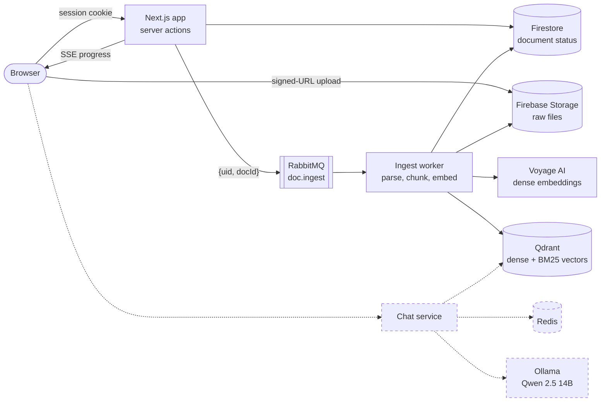

# DocuLyze

DocuLyze is a study tool my friends and I use to get through course material faster. You upload lecture notes, papers, slides, or code, and DocuLyze turns them into a searchable knowledge base you can ask questions against, with answers grounded in your own documents (retrieval-augmented generation).

It is built as separate services: a Next.js web app, a Python ingest pipeline behind a RabbitMQ queue, and (in progress) a chat service that generates answers locally with Qwen 2.5 through Ollama.

## Status

| Area | Status |
|---|---|
| Accounts, sign-in, and sessions | Built |
| Document upload and archive | Built |
| Ingest pipeline (parse, chunk, embed, index) | Built |
| Live pipeline progress (SSE) | Built |
| Hybrid retrieval (dense + BM25 with RRF) | Built |
| Retrieval evaluation harness | Built |
| Chat service (Redis cache, SSE token streaming, Qwen 2.5 14B via Ollama) | Built |
| CI/CD with GitHub Actions | Built |
| Kubernetes deployment with autoscaling | In progress (manifests not yet in the repo) |

## Architecture



Dashed boxes and arrows are in progress.

### Web app (`doculyze/`)

Next.js 16 (App Router), React 19, TypeScript, and Tailwind CSS v4. Server actions act as the backend, so there is no separate API server.

- **Auth.** Firebase email/password sign-in. The ID token is exchanged for an httpOnly session cookie, and every data read and write is authorized from that cookie on the server, never from client state.
- **Upload.** Files go straight from the browser to Firebase Storage through a short-lived signed URL (up to 5 MB). The server picks the storage path and content type, then verifies the object landed before writing the Firestore record. PDF, Word (.docx), Markdown, plain text, HTML, and common source-code files are accepted.
- **Hand-off to ingest.** After an upload is confirmed, the app publishes a small `{uid, docId}` message to RabbitMQ. The file bytes never go through the queue. A broker outage never fails an upload: the document waits at `uploaded` and can be picked up later.
- **Live progress.** A per-document Server-Sent Events stream shows each upload moving through Uploading, Queued, Parsing, and Ready (or Failed).
- **Archive.** The dashboard lists your documents and their processing status.
- **Logging.** Structured operational logs through Winston with daily file rotation.

### Ingest worker (`ingest-worker/`)

A Python 3.12 service that consumes the `doc.ingest` queue one message at a time with manual acknowledgement.

1. **Claim.** A Firestore transaction moves the document from `uploaded` to `processing`, with a lease that expires so a crashed worker's job can be safely re-run.
2. **Check.** A magic-number precheck rejects files whose bytes don't match their claimed type.
3. **Parse to Markdown** in a sandboxed subprocess with a per-parser timeout:
   - PDFs: PyMuPDF (`pymupdf4llm`), the fast path for PDFs that have a text layer
   - Scanned PDFs with no text layer: a second pass with Docling and RapidOCR
   - Word, HTML, and XML: Docling, which keeps headings and tables
   - Text and code: read as UTF-8, with code wrapped in fenced blocks
4. **Chunk.** Header-aware and table-aware splitting with LangChain's `MarkdownHeaderTextSplitter` and `RecursiveCharacterTextSplitter`, sized with `tiktoken`.
5. **Embed and index.** Each chunk gets a dense Voyage `voyage-3.5-lite` vector and a sparse BM25 vector (fastembed). Both are written to Qdrant through a tenant gateway that applies the user filter itself, so no caller can read or write across users.
6. **Finish.** The worker reads the chunks back to confirm the write, then marks the document `ready`. Bad files end at `failed`.

A document that is temporarily busy goes to a retry queue and comes back after five minutes. Unexpected errors go to a dead-letter queue (`doc.ingest.dead`) instead of retrying forever, so a non-empty dead queue always means something is wrong with the system, not with a user's file.

### Chat service 

The chat service runs as its own backend:

- Retrieve with Qdrant hybrid search (dense + BM25, fused with RRF), optionally reranked with Voyage `rerank-3-lite`.
- Generate answers locally with **Qwen 2.5 14B served by Ollama**, so study material never leaves our machines for generation.
- Cache conversation context and repeated retrievals in **Redis**.
- Conversations are saved into Firestore for persistence.
- Stream answers token by token to the browser over **SSE**.

Qwen 2.5 has already been prototyped through Ollama for extracting named entities from documents.

## Retrieval evaluation

The `ingest-worker/src/ingest/mytests/` scripts measure retrieval quality before the chat layer is built on top of it:

- **Recall@k and NDCG@k** against hand-labelled relevant chunks for an Alphabet Q1 2026 earnings release (`experimental_results/sample_q&a/google_questions.json`).
- **RAGAS** context precision and recall, judged by an LLM.
- **UDA benchmark** subsets (TAT-QA hybrid, paper text, and paper tables), padded with unrelated "noise" documents so retrieval has to find the right document as well as the right chunk.
- **Strategy comparison** across embedding-only, hybrid, and reranked retrieval (`test_reranker.py`).

On 26 single-document questions over the earnings release, recall@3 was:

| Strategy | Recall@3 |
|---|---|
| Embedding only | 0.77 |
| Hybrid (dense + BM25, RRF) | 0.86 |
| Embedding + rerank | 0.90 |
| Hybrid + rerank | 0.90 |

This is a small, single-document test set, so treat these as directional numbers rather than a benchmark result.

## Testing

| Suite | Framework | Tests | Runs against |
|---|---|---|---|
| Web app (`doculyze/tests/`) | Vitest | 157 | Firebase emulators (Firestore, Storage, Auth) |
| Ingest worker (`ingest-worker/tests/`) | pytest | 127 | Firestore emulator, with faked embedders and an in-memory Qdrant |

Tests target external behavior at stable seams, such as the `run_ingest_job` entry point and the vector-store gateway, rather than implementation details.

## Running locally

### Prerequisites

- Node.js 22 and npm
- Python 3.12
- Docker (for RabbitMQ and the ingest worker)
- Firebase CLI (for the emulators)
- A Firebase project, a Qdrant cluster, and a Voyage AI API key

### Configuration

| File | Contents |
|---|---|
| `.env` (repo root) | `QDRANT_URL`, `QDRANT_API_KEY`, `VOYAGE_API_KEY`, plus `OPENAI_API_KEY` for the RAGAS evals. Docker Compose also reads this file. |
| `doculyze/.env` | Firebase client and Admin config, plus `FIREBASE_STORAGE_BUCKET`. See `doculyze/.env.example`. |
| `doculyze/serviceAccount.json` | Firebase Admin credentials. Gitignored; also mounted into the worker container. |

`cors.json` is the Storage bucket CORS configuration that lets the browser upload directly. Apply it with `gsutil cors set cors.json gs://<bucket>`.

### Start the services

```bash
# RabbitMQ + ingest worker
docker compose up -d

# Web app on http://localhost:3000
cd doculyze
npm install
npm run dev
```

For local development against the Firestore emulator, add the dev override: `docker compose -f docker-compose.yml -f docker-compose.dev.yml up -d`.

### Run the tests

```bash
cd doculyze
npm run test:emulators

cd ../ingest-worker
python -m venv .venv && .venv/Scripts/pip install -r requirements.txt   # bin/ instead of Scripts/ on macOS/Linux
npm --prefix ../doculyze run emulators   # in a separate terminal
.venv/Scripts/python -m pytest tests
```

## Roadmap

- **Chat service.** Separate backend with hybrid retrieval, reranking, Qwen 2.5 14B generation through Ollama, Redis caching, and SSE token streaming.
- **CI/CD.** GitHub Actions running the Vitest and pytest suites against the Firebase emulators on every push and pull request, then building and publishing the service images.
- **Kubernetes.** Run the web app, ingest worker, and RabbitMQ on Kubernetes with:
  - ingest workers that **autoscale on RabbitMQ queue depth**, so a burst of uploads adds workers and an idle queue scales them back down
  - **rolling deployments** so updates ship without downtime
- **Qwen 2.5 fine-tuning.** Fine-tune Qwen 2.5 on study-style question and answer pairs so answers stay closer to the source material.
- **Entity-aware retrieval.** Tag chunks with named entities at ingest time and use them to boost matching results at query time.
- **Google sign-in** alongside email and password.

## Repository layout

```
DocuLyze/
├── doculyze/               Next.js web app (server actions, SSE route, Vitest suite)
├── ingest-worker/          Python ingest service (RabbitMQ consumer, parsers, chunker, Qdrant gateway)
│   ├── src/ingest/mytests/ Retrieval evaluation scripts
│   └── experimental_results/  Evaluation source documents and labelled questions
├── docker-compose.yml      RabbitMQ + ingest worker
├── docker-compose.dev.yml  Dev override: worker uses the host's Firestore emulator
└── cors.json               Storage bucket CORS config for direct browser uploads
```

## How the design changed

This README replaces the original `PLAN.md`, which sketched a React and Express app with MongoDB, ChromaDB, Redis, and the Google Natural Language API. Since then:

- **MongoDB was replaced by Firestore** for metadata, with raw files in Firebase Storage.
- **Express was replaced by Next.js server actions**, so the web app needs no separate API server.
- **ChromaDB was replaced by Qdrant** to support hybrid dense + BM25 retrieval.
- **The Google Natural Language API was dropped.** It couldn't extract concepts and struggled with Markdown tables, so entity extraction moved to a local LLM.
